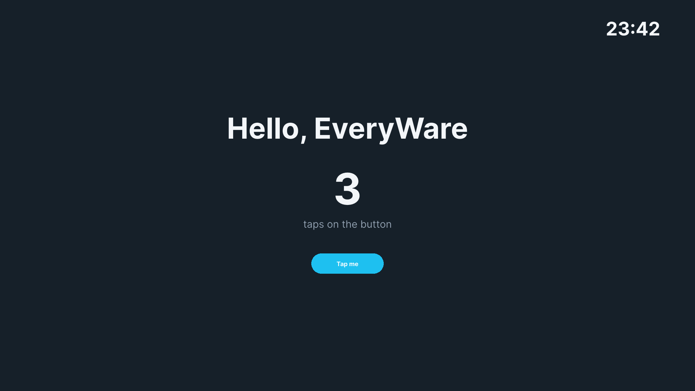

# template-app

The template of a new EveryWare app: a harry app on the EveryWare UI library (1920 x 1080) with
the time, a title, a number and a button of the library that counts up. It knows no use case:
it shows the whole loop of an app (a tap, an action, the state, the presenter, a library
component) and nothing else. ui-lib's `scripts/new-app.sh` copies it into a new app.



## A new app from it

```bash
vendor/sdv-everyware/ui-lib/scripts/new-app.sh kitchen    # -> packages/services/display_safety/utils/kitchen-app
```

The script copies this repository's committed files, renames every name of the template
(`template_app`, `TemplateAction`, `#template-root`, `#template/*`, `template.dcf`) and makes a
git repository of its own. With a coding agent, the `new-app` skill does the same from one
sentence and then draws the new screen (`vendor/sdv-everyware/ui-lib/skills/new-app/SKILL.md`).

## What is in it

| Path | What |
|---|---|
| `design/template-patch.js` | the screen: texts and a `#button` slot under `#template-root` |
| `design/build.sh` | builds the design: `design/template.fig` and `data/template.dcf` |
| `src/state.rs` | what the screen knows: the clock, the count, the button |
| `src/actions.rs` | the clock's tick, and a tap on `#template/tap` that counts up |
| `src/presenter.rs` | the state to the UI model, after every action |
| `src/ui_model.rs` | the three names the code writes to or taps: the contract with the design |
| `src/main.rs` | the frame around it: the display, the fonts, the clock's thread, the touch |

To make it your app: replace the screen in `design/template-patch.js`, the fields in
`src/ui_model.rs`, `src/state.rs` and `src/actions.rs`; keep `src/main.rs`, `config.rs`,
`clock.rs`, `resource_loader.rs` and `ui_event_listener.rs` as they are.

## The design

`data/template.dcf` is made without Figma: `design/template-patch.js` (the screen, `#template-root` from Library
slots) on the EveryWare Library, then ui-lib's `design/dark-theme-patch.js`, then `fig-to-dcf.sh`.
`design/build.sh` runs the whole chain:

```bash
packages/services/display_safety/utils/template-app/design/build.sh     # from anywhere
```

It builds the Library (ui-lib `design/build-library.sh`, `design/build/library.fig` there), this
app's `design/template.fig` (in git: the file a designer opens, see below) and
`data/template.dcf`; `CHECK='#template/time #template/...'` names what must be in the .dcf.
fig-to-dcf.sh imports with everyware's `tools/dcf` (dcf-fetch `--local`, on our fork of
DesignCompose).

The names under `#template-root` (`#template/*`) are the contract with `src/ui_model.rs`: rename both or neither.

## The design in Figma, without scripts

`design/template.fig` is this app's screen as a Figma file: what is built, checked into git, and
what a designer opens. The plain path, no agent and no tools:

1. **Open it**: Figma, File > Import, `design/template.fig`. The screen is the frame `#template-root`;
   the Library (the components the screen is made of) is on its Components page.
2. **Change it** as in any Figma file: move, recolour, add a layer, swap an instance's variant.
   The layer names starting with `#` are the contract with the code (`src/ui_model.rs`): keep
   them; a new element the app should drive gets a `#template/<name>` of its own, and the app a
   field with that name.
3. **Hand it over**: share the Figma file. The developer fetches it into the app once, from
   the tree's top, with a Figma token exported in the shell (never written down):
   `FIGMA_TOKEN=... vendor/sdv-everyware/everyware/scripts/fetch-dcf.sh packages/services/display_safety/utils/template-app/data/template.dcf <file key>`
   (the key is in the file's URL, `figma.com/design/<key>/...`), and the board shows it.

What the scripts add on top is only the other direction: `design/build.sh` writes this `.fig`
from `design/template-patch.js` (an agent's or a developer's drawing in code) and the Library, and
makes the `.dcf` without Figma. Both ways meet in the same `.fig` and the same `.dcf`; the
`#names` are what keeps them together.

## Build and run on the RB3

```bash
# from the tree's top: build (sdv_media_db845c, out_rb3)
source device/rb3/sdv_media_db845c/tools/env.sh; m template_app

# the display has one app at a time: stop the installed panel first (adb shell stop smarthome)
adb shell mkdir -p /data/local/tmp/template
adb push out_rb3/target/product/sdv_media_db845c/system/bin/template_app /data/local/tmp/template/
adb push packages/services/display_safety/utils/template-app/data/template.dcf /data/local/tmp/template/
adb shell "cd /data/local/tmp/template; LD_LIBRARY_PATH=/system/lib64:/vendor/lib64:/apex/com.everyware.smarthome/lib64 \
    ./template_app --data-path /data/local/tmp/template --touch-size 1920x1080"
```

The fonts are compiled in (`data/*.otf`); the time comes from the board's clock.
`adb shell start smarthome` brings the installed panel back.
